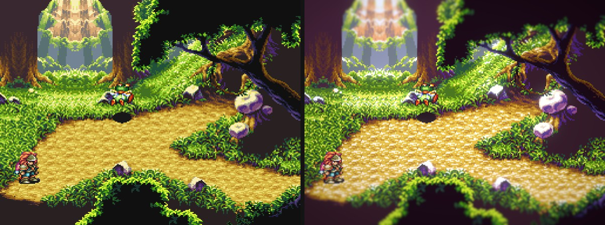
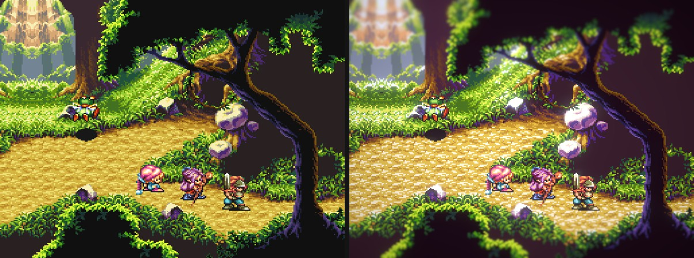
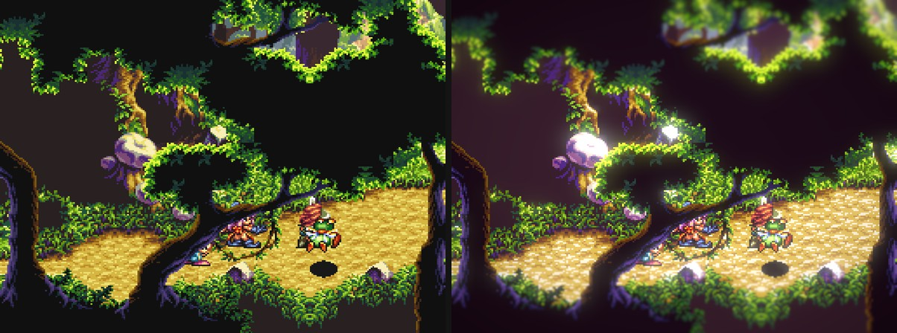
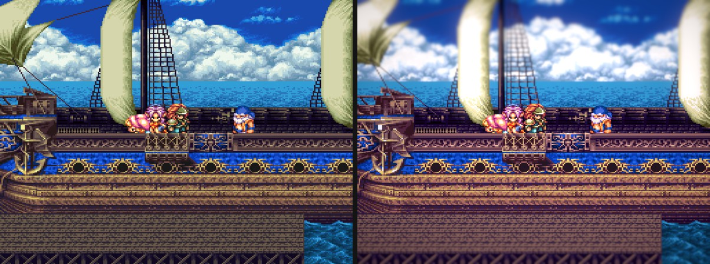
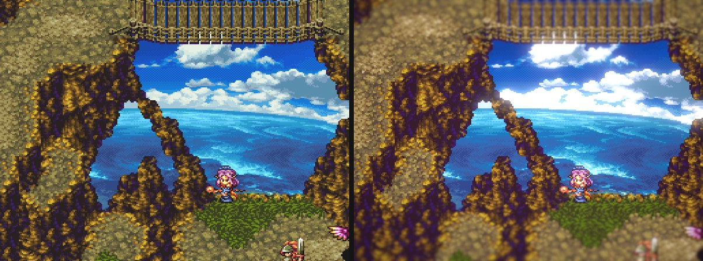
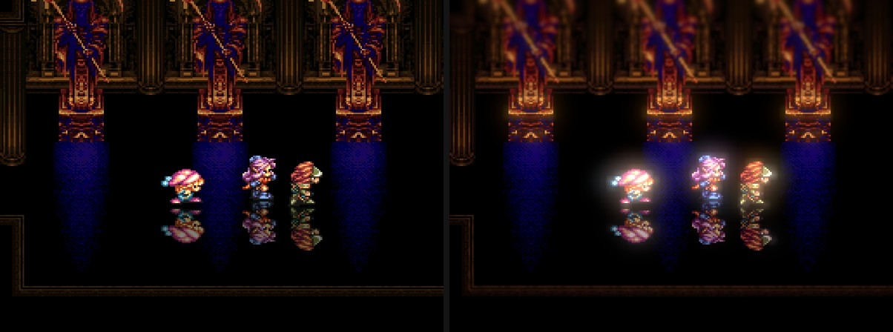

# Pixel Diorama

A RetroArch shader that gives SNES games a "diorama" look: richer colour, soft glow, a gentle depth-of-field
blur that follows the moving characters, and a light vignette. The pixel art itself stays as it is: no
upscaling filter, no camera change, and no frame ends up duller or flatter than the original.

It is a post-processing shader only. It does not modify the game ROM or the emulator.

> This is my personal vibe-coding practice project, made for fun. It is not affiliated with or endorsed by
> any game publisher. Expect rough edges.

## Before / after

Trials of Mana (Snes9x core), left: original, right: Pixel Diorama with default settings.

## Install

Requirements: RetroArch with a Vulkan, Direct3D 11/12 or OpenGL 3+ (glcore) video driver (slang shaders),
and any SNES core (tested with Snes9x on Direct3D 11, RetroArch 1.22.2).

1. Copy this folder into RetroArch's `shaders` folder, e.g. `RetroArch/shaders/pixel-diorama/`.
2. Start a game, open **Quick Menu > Shaders > Load**, and pick `pixel-diorama/pixel-diorama.slangp`.
3. Optional: **Save > Save Core Preset** to use it for every SNES game.

## Settings

Every setting is a slider under **Quick Menu > Shaders > Shader Parameters**.

| Parameter | Default | What it does |
|---|---|---|
| Colour look strength | 1.5 | Strength of the colour look (0 = original colours) |
| Glow amount | 2.0 | Brightness of the glow around bright areas (0 = off) |
| Glow threshold | 2.0 | How bright a pixel must be to glow (std above the frame's mean brightness) |
| Glow radius 1 / 2 | 8 / 32 | Size of the two glow layers (px at 1080p) |
| Depth of field strength | 3.0 | Blur away from the focus row (0 = off) |
| Depth of field: sharp half-width | 0.2 | Height of the sharp band around the focus (fraction of the screen) |
| Depth of field: blur slope / base blur | 6.28 / 0.03 | How fast the blur grows away from the sharp band |
| Depth of field follows the moving characters | 1 | 1 = focus follows motion, 0 = fixed focus row |
| Focus follow time constant | 0.5 s | How quickly the focus moves to a new position |
| Haze/focus centre | 0.39 | Fixed focus row when following is off (0 = top, 1 = bottom) |
| Depth haze | 0.0 | Fades the top of the screen toward the scene's mean colour |
| Vignette strength / falloff power | 1.0 / 2.2 | Darkening toward the corners |
| Chromatic aberration at corner | 0.0 | Colour fringing toward the corners (px at 1080p) |

## Known limits

- The focus needs about half a second to move to a character that appears suddenly.
- Screens that are mostly text (menus, dialogue boxes) also get the depth-of-field blur at the top and bottom;
  lower *Depth of field strength* or set it to 0 if that bothers you.

## License

MIT, see [LICENSE](LICENSE). Game screenshots are shown only to illustrate the shader's effect; the game and its
artwork belong to their respective owners.
